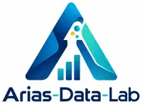

# Banco de Problemas del Caribe · Arias-Data-Lab

**Profesor: Leonardo Arias-Alemán**  
**Marca:** Arias-Data-Lab  
**Lema:** *Tecnología con criterio humano.*

Sitio educativo de 30 enunciados caribeños para aprender ingeniería de bases de datos, con un **Prompt Maestro de Vibe Coding supervisado**, guía de documentación y perfil profesional.

### Páginas
- [Banco de enunciados](https://ljarias.github.io/banco-problemas-caribe/)
- [Prompt maestro](https://ljarias.github.io/banco-problemas-caribe/prompt-maestro.html)
- [Guía para documentar bases de datos](https://ljarias.github.io/banco-problemas-caribe/guia-documentacion.html)
- [Acerca de](https://ljarias.github.io/banco-problemas-caribe/acerca-de.html)

### Identidad visual v3
Fuente: kit de identidad corporativa **Arias-Data-Lab v3.0**, aprobado por el autor.

| Color de interfaz | Hex |
|---|---|
| Azul profundo | `#102A43` |
| Turquesa | `#087F8C` |
| Celeste | `#D7F1F5` |
| Amarillo | `#F4B942` |
| Blanco hielo | `#F6F9FC` |
| Gris | `#475569` |

El archivo `assets/logo-adl-v3.webp` es una **versión reducida para interfaz** obtenida del logo a color con fondo transparente del kit oficial; no es un rediseño del símbolo. `assets/favicon-32.png` es el icono original de 32 × 32 px. Para impresión y producción de alta calidad debe utilizarse el kit maestro suministrado por el titular de la marca.

**Nota:** el logo aprobado contiene una A azul/turquesa, tres nodos (incluido el amarillo), tres barras ascendentes y el nombre Arias-Data-Lab. No se sustituyen por diseños alternativos.

### Desarrollo
Sitio HTML estático alojado en GitHub Pages. Las 4 páginas están enlazadas entre sí, y la hoja `assets/adl-brand-v3.css` centraliza la paleta corporativa.

© 2026 Arias-Data-Lab · Santa Marta, Colombia.

## Patrón ADL v3.1 (2026-10-11)

Identidad corporativa aplicada al catálogo y las páginas Acerca de, Guía de documentación y Prompt maestro. El recurso `assets/logo-adl-v3.webp` es una miniatura web optimizada, derivada de la imagen que el propietario aprobó sin rediseñarla. El original de máxima resolución permanece en el kit maestro externo y **no es un SVG vectorial editable**. El favicon existente corresponde al isotipo aprobado. Colores: `#102A43`, `#087F8C`, `#D7F1F5`, `#F4B942`.

Cambios: archivo CSS central compartido; pie de página con créditos y firma; adaptaciones responsive sin modificar las fichas de problemas, el prompt ni las funciones JavaScript.
