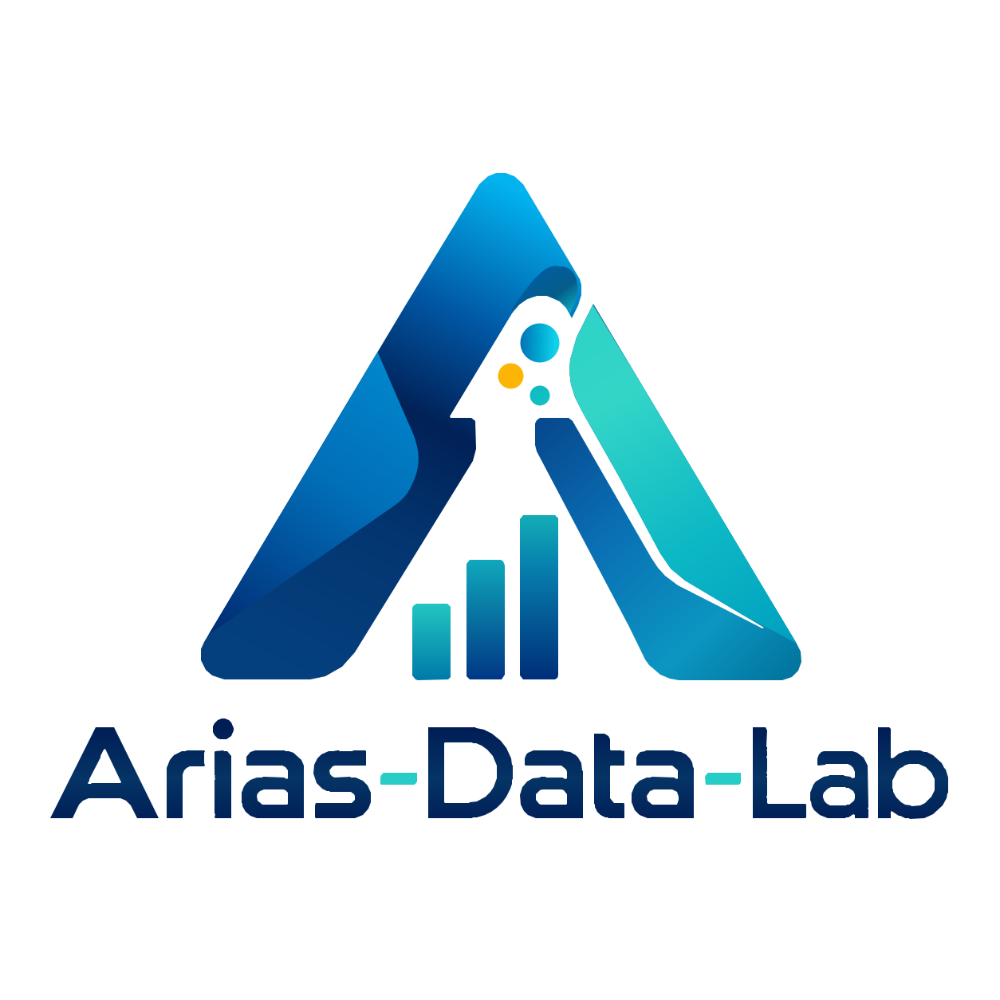

# Banco de Problemas del Caribe · Arias-Data-Lab

**Profesor: Leonardo Arias-Alemán**  
**Marca:** Arias-Data-Lab  
**Lema:** *Tecnología con criterio humano.*

Sitio educativo de 30 enunciados caribeños para aprender ingeniería de bases de datos, con un **Prompt Maestro de Vibe Coding supervisado**, guía de documentación y perfil profesional.

### Páginas
- [Banco de enunciados](https://ljarias.github.io/banco-problemas-caribe/)
- [Prompt maestro](https://ljarias.github.io/banco-problemas-caribe/prompt-maestro.html)
- [Guía para documentar bases de datos](https://ljarias.github.io/banco-problemas-caribe/guia-documentacion.html)
- [Acerca de](https://ljarias.github.io/banco-problemas-caribe/acerca-de.html)

### Identidad visual v4.0
Fuente oficial: [kit de identidad corporativa vectorial Arias-Data-Lab v4.0](../assets/brand/logo/v4.0/README.md), aprobado por el autor.

| Color de interfaz | Hex |
|---|---|
| Azul profundo | `#102A43` |
| Turquesa | `#087F8C` |
| Celeste | `#D7F1F5` |
| Amarillo | `#F4B942` |
| Blanco hielo | `#F6F9FC` |
| Gris | `#475569` |

Las cuatro páginas utilizan actualmente el SVG multicolor oficial en `../assets/brand/logo/v4.0/ADL_logo-maestro-color_EDITABLE_v4.0.svg`. El favicon SVG usa el isotipo cuadrado aprobado, con `assets/favicon-32.png` como alternativa para navegadores antiguos. El archivo `assets/logo-adl-v3.webp` continúa disponible como respaldo histórico, pero ya no se utiliza como imagen de marca principal.

**Nota:** el logo aprobado contiene una A azul/turquesa, tres nodos (incluido el amarillo), tres barras ascendentes y el nombre Arias-Data-Lab. No se sustituyen por diseños alternativos.

### Desarrollo
Sitio HTML estático alojado en GitHub Pages. Las 4 páginas están enlazadas entre sí, y la hoja `assets/adl-brand-v3.css` centraliza la paleta corporativa.

© 2026 Arias-Data-Lab · Santa Marta, Colombia.

## Patrón ADL v3.1 (2026-10-11)

Identidad corporativa aplicada al catálogo y las páginas Acerca de, Guía de documentación y Prompt maestro. El recurso `assets/logo-adl-v3.webp` es una miniatura web optimizada, derivada de la imagen que el propietario aprobó sin rediseñarla. En aquel momento el SVG vectorial editable aún no estaba disponible; **esto fue resuelto posteriormente con el maestro aprobado v4.0**. El favicon PNG legado permanece como respaldo. Colores: `#102A43`, `#087F8C`, `#D7F1F5`, `#F4B942`.

Cambios: archivo CSS central compartido; pie de página con créditos y firma; adaptaciones responsive sin modificar las fichas de problemas, el prompt ni las funciones JavaScript.

## Migración del sistema de identidad SVG v4.0 — 12/10/2026

Migrados encabezados, pie de página, miniaturas de marca y fondos decorativos de las cuatro páginas a los SVG oficiales centralizados. Sin alterar scripts, ejercicios, prompt maestro, datos, perfiles, ni archivos privados. [Registro de QA y alcance](../assets/brand/MIGRACION-SITIOS-V4.md).
